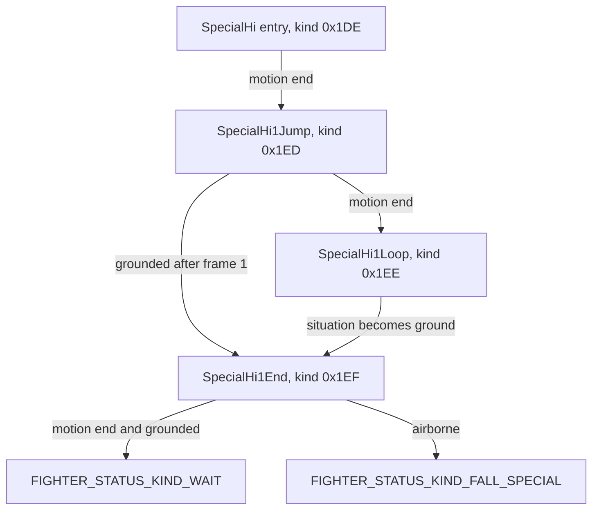

# Hero Spin (Mii Swordfighter up-B) onto Mythra c07 — plan and evidence

> **Correction, 2026-09-26:** This plan misidentifies the donor. Mii
> Swordfighter's `Hi1` is **Stone Scabbard**, the upward leap followed by a
> downward thrust. **Hero's Spin is `Hi3`.** Every `Hi1` clip, status, ACMD,
> parameter and manifest entry below describes Stone Scabbard, regardless of its
> old Hero Spin label. Do not use this plan to build Hero's Spin. The current
> `src/hero_spin.rs` and five shipped c07 clips follow this mistaken `Hi1` plan.
> The local dump has `d02specialairhi3.nuanmb` but lacks the three ground `Hi3`
> clips (`d02specialhi3start`, `d02specialhi3hold`, `d02specialhi3`).

Status: evidence gathered and feasibility measured; no code written yet.
Scope chosen by the user: **full transplant** — donor ACMD, recipient-authored
statuses, retargeted donor clips. Same shape as the Monkey Flip port.

Everything below is measured from files in this workspace. Nothing here is from
memory, and every value names the file it came from.

## 1. Donor motion slots (from `motion_list_body_c00.yml`, fetched by
`scratch/fetch_hero_spin_references.py`)

| donor motion key | game script | clip | cancel frame |
|---|---|---|---|
| `special_hi1_start` | `game_specialhi1start` | `d02specialhi1start.nuanmb` | 0 |
| `special_air_hi1_start` | `game_specialairhi1start` | `d02specialairhi1start.nuanmb` | 0 |
| `special_air_hi1` | `game_specialairhi1` | `d02specialairhi1.nuanmb` | 0 |
| `special_air_hi1_loop` | `game_specialairhi1loop` | `d02specialairhi1loop.nuanmb` | 0 |
| `special_hi1_end` | `game_specialhi1end` | `d02specialhi1end.nuanmb` | **45** |

`Hi1` is Hero Spin. `Hi2`/`Hi3` are the Mii's other two up-B options and are not
being ported; they were fetched only so that "which one is Hero Spin" could be
answered from the status list rather than from the number in the filename, and the
status list settles it: Hero Spin is the chain
`SpecialHi` -> `SpecialHi1Jump` -> `SpecialHi1Loop` -> `SpecialHi1End`.

## 2. Recipient slots, and the carrier mapping

The engine only loads an animation whose name exists in the base install (the
Monkey Flip lesson). Mythra already has six up-B motion slots, so every donor clip
has a home and **no new animation name is introduced**:

| donor | recipient slot (exists) | recipient clip |
|---|---|---|
| `special_hi1_start` | `special_hi_start` | `d02specialhistart.nuanmb` |
| `special_air_hi1_start` | `special_air_hi_start` | `d02specialairhistart.nuanmb` |
| `special_air_hi1` | `special_air_hi_jump` | `d02specialairhijump.nuanmb` |
| `special_air_hi1_loop` | `special_air_hi1` | `d02specialairhi1.nuanmb` |
| `special_hi1_end` | `special_air_hi_end` | `d02specialairhiend.nuanmb` |

`special_air_hi2` stays free (it is Chroma Dust's extra phase). Because the mapping
is 1:1 onto existing names, this move needs **no `motion_list.bin` surgery** — the
statuses simply ask for the recipient's own slots, unlike Monkey Flip which had to
repoint slots at carriers.

`elight`'s **esword** motion list has no up-B entries at all (`0 keys containing
"hi"`), so no sword clip is written. Whether the sword looks right during the spin
is an open question for the Switch test, not something the donor can answer.

## 3. Retarget feasibility (measured by `scratch/analyse_hero_spin.py`)

Recipient skeleton `fighter/elight/model/body/c07/model.nusktb`, 169 bones.

| donor clip | frames | transform tracks | survive on Mythra bones | dropped |
|---|---|---|---|---|
| `d02specialhi1start` | 13 | 75 | 64 | 11 |
| `d02specialairhi1start` | 13 | 75 | 64 | 11 |
| `d02specialairhi1` | 45 | 75 | 64 | 11 |
| `d02specialairhi1loop` | 6 | 75 | 64 | 11 |
| `d02specialhi1end` | 60 | 75 | 64 | 11 |

The 11 dropped tracks are all Mii-specific: `FingerL14_eff`, `FingerL24_eff`,
`FingerL34_eff`, `FingerL44_eff`, `FingerL54_eff`, `FingerR14_eff`, `FingerR24_eff`,
`FingerR34_eff`, `FingerR44_eff`, `FingerR54_eff`, `Miihead`.

For comparison, Monkey Flip kept 37 of 84 tracks. This is a much better fit — both
fighters are humanoid swordfighters.

Group structure: the donor clips carry **Transform + Visibility** only. The
recipient's own clips carry **Transform + Visibility + Material**. So the port keeps
the donor's Transform group after intersection and installs recipient-sourced
Visibility and Material groups, exactly as `tools/build_monkey_flip_assets.py` does
for Game & Watch.

## 4. What the donor entry status does (from `status/SpecialHi__main.c`)

- runs a shared setup helper, then sets
  `FIGHTER_STATUS_WORK_ID_FLOAT_RESERVE_KINETIC_MOTION_SPEED_MUL` from a param
  (donor hashes `0x1086bc4a93`, `0x12b414540b`);
- turns `FIGHTER_MIISWORDSMAN_INSTANCE_WORK_ID_FLAG_MOT_FRAME_INHERIT` **off**;
- stores its two start motions as work ints — `INT_GROUND_MOT = 0x110a6a8158`,
  `INT_AIR_MOT = 0x157c377547`, i.e. `hash40` motion names — which is how the donor
  chooses between the ground and air start;
- fires the attack-number logging events;
- hands off to `SpecialHi_main_loop`.

The port can follow this directly: keep the ground/air start choice, turn frame
inherit off, and take the speed multiplier from the donor's `vl.prc`.

## 5. Donor ACMD facts (from `acmd/SpecialHi1.txt`)

- frames 1 and 3: two `ATTACK` boxes (size 4.0 and 3.5, angle 92, damage 4.0) on
  `hash40("top")` with the three-`Option` two-point form
  (`Some(0.0), Some(4.0), Some(6.0)`) — the same optional-triple shape that the
  Monkey Flip `CATCH` bug was about, so it is worth checking how `macros::ATTACK`
  pushes those options rather than assuming;
- frame 7: `notify_event_msc_cmd!(GROUND_CLIFF_CHECK_KIND_ALWAYS_BOTH_SIDES)`;
- frame 30: two final `ATTACK` boxes on `hash40("haver")` (size 5.0);
- frame 32: `WorkModule::on_flag(FIGHTER_MIISWORDSMAN_STATUS_WORK_ID_FLAG_ROKET_UNDER_DISABLE_CONTROL_X)`;
- effects name Mii-specific things: `miiswordsman_rocket_aura`,
  `miiswordsman_rocket_stab`, and
  `EFFECT_FOLLOW_WORK(*FIGHTER_MIISWORDSMAN_INSTANCE_WORK_ID_INT_EFT_ID_SWORD_FLARE)`.

The Mii-only flag and the Mii-only effect ids have to be **mapped to elight
equivalents or deliberately dropped** — not pasted, which is one of the ways the
2026-09-15 attempt went wrong.

## 6. What the previous attempt did, and why it failed

`DIAGNOSIS.md` (lines 231+), "Up-B cleanup": the attempt lived in `src/special_hi.rs`
and "replaced Mythra's native up-B status flow with Elight status callbacks and mixed
custom motion/ACMD names (`special_hi_start`, `special_air_hi_jump`, `special_air_hi1`,
`special_air_hi2`). That left native Mythra transitions and the attempted Mii-style
scripts active together."

Two things to note. Those motion names are legitimate — they are the recipient's own
slots, so the *names* were not the problem. The problem was overlapping authority:
native statuses still running while Mii-shaped scripts were also installed.

That file no longer exists. `src/` currently holds `attack_air_f.rs`,
`attack_air_hi.rs`, `diagnostics.rs`, `lib.rs`, `monkey_flip_params.rs`,
`monkey_flip_status.rs`, `monkey_flip.rs`, `swap_handoff.rs`, `throw_lw.rs` — so the
up-B work was fully reverted and Mira's up-B is 100% native. This is a clean start.

## 7. Open items before code — items 1 to 3 answered 2026-09-18

The five items were the analysis phase. Items 1, 2 and 3 are done and are
sections 8, 9 and 10 below. Item 4 (registration) is not answered here; section 11
records the status-kind and id facts that registration has to respect. Item 5 is
section 12, which states the retarget plan in terms of the checks
`tools/build_monkey_flip_assets.py` already asserts. Section 13 lists what is not
in the tree, which is the part that must not be inferred.

## 8. Donor status order, descent and landing, with the file each condition lives in

### 8.1 The pinned files

Every status dump below is in `status/` and is pinned in `manifest.json` with its
URL, byte count and SHA-256. The dumps are Ghidra's decompilation of
`lua2cpp_miiswordsman.nro` from Coolsonickirby/SSBU-Dumped-Status-Scripts at
revision `b6bb1fec`, so function and operand names are the decompiler's, not
Nintendo's.

| file | bytes | sha256 |
|---|---|---|
| `status/SpecialHi__pre.c` | 4030 | `3ecea2a2c43a5ea67884aee3e1caf4658d5e9c2313f3d39c986304327d62ff3e` |
| `status/SpecialHi__main.c` | 4085 | `9f9ff0b7ee40b2bb174b5db4921f952e939664bf9a777093696f8924b79ec48e` |
| `status/SpecialHi__main_loop.c` | 3600 | `005fa3b2b716392d960a5af397e7e020faa9d1c3dd107e417b700eb1d2150ebd` |
| `status/SpecialHi__end.c` | 1224 | `a47aec38338ff71c82fd5af1e85855e16c49bb41c738025d374e1a7b1d417014` |
| `status/SpecialHi1Jump__pre.c` | 4080 | `7102f7dfb779b2e21d11acaf96c589acb7f27a52f07ecdcee52b7ccd414abd28` |
| `status/SpecialHi1Jump__main.c` | 1584 | `197192a32d1b5174eb7fcd3fd7d90adb94f753fd536e62dd76b384cf4cff7c00` |
| `status/SpecialHi1Jump__main_loop.c` | 2251 | `ca21edfc3160afb588bf7436433db3699b5c007d4fea48d93f0a17e5c26e6e27` |
| `status/SpecialHi1Jump__end.c` | 883 | `5778d72e1c18b6ed88ff1c87ce076f6b8873634863a7be89b2da920422ffe9a7` |
| `status/SpecialHi1Loop__pre.c` | 4103 | `4aefd5a3cc7c2a5c41242b2fac5d302fdf7a1f3fd17a317371b5f442db7ae191` |
| `status/SpecialHi1Loop__main.c` | 1586 | `46adb600e5cb0affd4ae33d6b1bd000a58a1d659adebb5b26c178179120e5704` |
| `status/SpecialHi1Loop__main_loop.c` | 1278 | `b3fd55a1918341b53f371ce10894c9d9d03b93f1a8e158d4f2aaa2bf4d219399` |
| `status/SpecialHi1Loop__end.c` | 203 | `4207f7d4471cbe0ba89ef7c062cb20584da799971087ed5a4de1cdd2d8c7c5fd` |
| `status/SpecialHi1End__pre.c` | 4089 | `1ff08457a90b4e64bdd8755ec2f7ef0e0af5d2b7204055662d9736152f183ee3` |
| `status/SpecialHi1End__main.c` | 1582 | `052e9c6bbcd792b54e2144889bd2a55f954bb62ccde78b2362f8f73b43dbb1ad` |
| `status/SpecialHi1End__main_loop.c` | 3320 | `21d1d9a0d389ced2755c0e0485866c38961443592a9db26a2b11756629373eb4` |
| `status/SpecialHi1End__end.c` | 1424 | `47e6aac9162c1d20c21ddf8911b8c49d025820a404327471d4298f680d8e47b0` |

Functions that appear in every one of them and are **not** dumped anywhere in the
tree, so their bodies are unknown: `FUN_71000207c0` (first call in all four `main`
functions), `FUN_71000208c0` (after the motion selection), and, in the entry's
`main_loop` only, `FUN_7100021060` and `FUN_71000212b0`. They are call sites only.
Anything they do cannot be copied from this tree; see section 13.

### 8.2 Entry: `SpecialHi`

The entry's status kind is not named for the Mii: there is no
`FIGHTER_MIISWORDSMAN_STATUS_KIND_SPECIAL_HI` in the bindings, and the Mii's own
kinds start at `FIGHTER_MIISWORDSMAN_STATUS_KIND_PREV = 0x1E0`, so the entry is the
shared `FIGHTER_STATUS_KIND_SPECIAL_HI = 0x1DE`
(`skyline-smash` `src/lua_const.rs:19124`, revision `315e4e8`, the revision
`Cargo.lock` pins). That is an inference from absence and is marked as one; it
matters because it means the entry callbacks the port would have to divert are the
fighter-specific `L2CFighterMiiswordsman::status::SpecialHi_*` functions attached
to a kind every fighter has.

- `pre`: `StatusModule::init_settings(SITUATION_KIND_NONE, FIGHTER_KINETIC_TYPE_UNIQ,
  GROUND_CORRECT_KIND_KEEP, GROUND_CLIFF_CHECK_KIND_ON_DROP_BOTH_SIDES, true,
  keep = NONE_FLAG / NONE_INT / NONE_FLOAT)` at
  `status/SpecialHi__pre.c:32-52`, then `set_fighter_status_data` with
  `FIGHTER_LOG_MASK_FLAG_ATTACK_KIND_SPECIAL_HI | FIGHTER_LOG_MASK_FLAG_ACTION_CATEGORY_ATTACK |
  FIGHTER_LOG_MASK_FLAG_ACTION_TRIGGER_ON`, `_FIGHTER_STATUS_ATTR_START_TURN` and
  `_FIGHTER_POWER_UP_ATTACK_BIT_SPECIAL_HI` at `status/SpecialHi__pre.c:62-89`.
- `main`: reads the one speed parameter and writes it to
  `FIGHTER_STATUS_WORK_ID_FLOAT_RESERVE_KINETIC_MOTION_SPEED_MUL`
  (`status/SpecialHi__main.c:20-32`), turns
  `FIGHTER_MIISWORDSMAN_INSTANCE_WORK_ID_FLAG_MOT_FRAME_INHERIT` off
  (`:38-40`), stores the ground and air motion hashes into
  `FIGHTER_MIISWORDSMAN_INSTANCE_WORK_ID_INT_GROUND_MOT` / `INT_AIR_MOT`
  (`:42-53`), fires two attack-number log commands (`:56-79`), then
  `sub_shift_status_main(SpecialHi_main_loop)` (`:83-84`).
- `main_loop`: `sub_transition_group_check_air_cliff()` first (`:18`); if that did
  not transition, `MotionModule::is_end()` (`:22`) and on true
  `change_status(_FIGHTER_MIISWORDSMAN_STATUS_KIND_SPECIAL_HI1_JUMP)` (`:75-77`);
  otherwise the MTRANS situation sampling and `FIGHTER_MIISWORDSMAN_INSTANCE_WORK_ID_FLAG_MTRANS_SMPL_GROUND`
  / `_AIR` (`:34-65`) and the two unnamed helpers (`:66-71`).
- `end`: `_MA_MSC_CMD_EFFECT_AFTER_IMAGE_OFF` with `0`, issued only when a
  comparison of table slot `globalTable[0xb]` against
  `_FIGHTER_MIISWORDSMAN_STATUS_KIND_SPECIAL_HI1_JUMP` does **not** match
  (`status/SpecialHi__end.c:14-29`). The intended reading is "kill the afterimage
  unless we are in the jump status"; the table read itself is the decompiler's
  rendering and is the one line here whose exact operand should be re-read in the
  raw disassembly if the port ever needs it.

### 8.3 Jump: `SpecialHi1Jump` (kind `0x1ED`)

- `pre`: `init_settings(SITUATION_KIND_AIR, FIGHTER_KINETIC_TYPE_UNIQ,
  GROUND_CORRECT_KIND_AIR, GROUND_CLIFF_CHECK_KIND_ON_DROP, true,
  keep = _FIGHTER_STATUS_WORK_KEEP_FLAG_MIISWORDSMAN_ROKET_UNDER_THRUST_FLAG /
  _INT / _FLOAT)` at `status/SpecialHi1Jump__pre.c:33-44`; then
  `set_fighter_status_data` with the same log mask minus `ACTION_TRIGGER_ON`, work
  int `0` and `_FIGHTER_POWER_UP_ATTACK_BIT_SPECIAL_HI` (`:66-89`).
- `main`: `off_flag(MOT_FRAME_INHERIT)` (`:15-17`), both `INT_GROUND_MOT` and
  `INT_AIR_MOT` set to the same hash `0xff4037c3f` (`:19-31`),
  `sub_shift_status_main(SpecialHi1Jump_main_loop)` (`:34-35`).
- `main_loop`, the whole of it in order (`status/SpecialHi1Jump__main_loop.c:18-54`):
  1. `sub_transition_group_check_air_cliff()` (`:18`) — leaving `0` means this call
     transitioned, and nothing else runs.
  2. `MotionModule::is_end()` (`:22-25`) on true →
     `change_status(_FIGHTER_MIISWORDSMAN_STATUS_KIND_SPECIAL_HI1_LOOP)` (`:48-50`).
  3. otherwise, if `situation == _SITUATION_KIND_GROUND` (`:27-31`) **and**
     `MotionModule::frame()` compares true against `1.0` (`:32-38`) →
     `change_status(_FIGHTER_MIISWORDSMAN_STATUS_KIND_SPECIAL_HI1_END)` (`:39-41`).
     The comparison is rendered as `lib::L2CValue::operator_(aLStack64 /*1.0*/, aLStack80 /*frame*/)`;
     the operator is unnamed in the dump. The reading that matches the move is
     `frame > 1.0` (do not end on the launch frame itself). Confirm the direction
     rather than assuming it; the two readings differ only at frames 0 and 1.
  4. otherwise return `0` and keep running the jump.
- `end`: `_MA_MSC_CMD_EFFECT_AFTER_IMAGE_OFF` with `0`, unconditionally
  (`status/SpecialHi1Jump__end.c:13-19`).

### 8.4 Loop: `SpecialHi1Loop` (kind `0x1EE`)

- `pre`: byte-for-byte the same shape as the jump's `pre`
  (`status/SpecialHi1Loop__pre.c:33-89`), with one difference in the
  `init_settings` tail argument: `_FS_SUCCEEDS_KEEP_ATTACK` instead of `0`
  (`:44`).
- `main`: `off_flag(MOT_FRAME_INHERIT)` (`:15-17`), both motion work ints set to
  `0x148c74c766` (`:19-31`), `sub_shift_status_main(SpecialHi1Loop_main_loop)`
  (`:34-35`).
- `main_loop` (`status/SpecialHi1Loop__main_loop.c:16-33`):
  1. `sub_transition_group_check_air_cliff()` (`:16`).
  2. if `situation == _SITUATION_KIND_GROUND` → `change_status(SPECIAL_HI1_END)`
     (`:20-30`).
  3. otherwise return `0`.
- `end`: empty, returns `0` (`status/SpecialHi1Loop__end.c:7-8`).

Two consequences that are easy to miss and both are measured, not guessed:

- **The loop status never calls `MotionModule::is_end()`.** Its only exits are
  landing, the cliff transition group, or something outside the move. It is
  therefore a motion-driven loop, and the donor's clip is declared as one:
  `special_air_hi1_loop` carries `loop: true` in
  `motion_list_body_c00.yml:3904-3909`. The recipient slot the loop clip is written
  to, `special_air_hi1`, carries `loop: false`
  (`../mythra_ftilt/elight_body_motion_list.yml:3424-3429`). If the clip is written
  to that slot and nothing else changes, the six-frame clip plays once, the motion
  ends, and the status — which does not test for that — holds the last frame until
  landing. The loop flag is part of the port, not a detail of the asset; section 12
  makes it an asserted output of the retarget tool.
- No `is_end` guard also means the loop is entered only through the jump's motion
  end, and left only by grounding. That is the "exit order" the Monkey Flip port
  paid for: the loop is not the phase that decides anything.

### 8.5 End, descent and landing: `SpecialHi1End` (kind `0x1EF`)

- `pre`: `init_settings(_SITUATION_KIND_GROUND, _FIGHTER_KINETIC_TYPE_GROUND_STOP,
  GROUND_CORRECT_KIND_GROUND, GROUND_CLIFF_CHECK_KIND_NONE, true,
  keep = MIISWORDSMAN_ROKET_UNDER_THRUST_*)` (`status/SpecialHi1End__pre.c:33-44`),
  then the same `set_fighter_status_data` as the jump (`:66-89`). Note the forced
  `_SITUATION_KIND_GROUND` and `GROUND_CORRECT_KIND_GROUND`: the End phase is a
  grounded phase by construction, and the jump and loop are what carry the fighter
  to it.
- `main`: `off_flag(MOT_FRAME_INHERIT)` (`:15-17`), both motion work ints set to
  `0xf2250bb9a` (`:19-31`), `sub_shift_status_main(SpecialHi1End_main_loop)`
  (`:34-35`).
- `main_loop`, the descent and landing wiring
  (`status/SpecialHi1End__main_loop.c:20-84`):
  1. `CancelModule::is_enable_cancel()` (`:20`).
  2. if cancel is **not** enabled, straight to the motion-end path at `:28`
     (`LAB_7100035800`).
  3. if cancel **is** enabled: `sub_wait_ground_check_common(this, 0x80)` (`:63-64`);
     if that reads true, `sub_air_check_fall_common(this)` (`:74`); if that also
     reads true, fall into the motion-end path (`:82`), otherwise return `1` and
     keep waiting.
  4. motion-end path at `:28-31`: `MotionModule::is_end()`; if the motion has ended
     **and** `situation == _SITUATION_KIND_GROUND` (`:34-52`) →
     `change_status(_FIGHTER_STATUS_KIND_WAIT)` (`:53-55`).
  5. `LAB_71000358a4` at `:34-44`: if `situation == SITUATION_KIND_AIR` →
     `change_status(FIGHTER_STATUS_KIND_FALL_SPECIAL)` (`:42-44`).
  6. otherwise return `0`.
- `end` (`status/SpecialHi1End__end.c:19-31`): reads the **second** parameter and
  writes it to `FIGHTER_INSTANCE_WORK_ID_FLOAT_LANDING_FRAME`. This is the only
  place the landing length is set, and it is set on the way out of the End status,
  so it is what the following landing animation uses. It is `hi1_land_weak_frame`,
  not the similarly named `hi1_landing_frame`; section 9 has both hashes.

The End motion itself is 60 frames with a cancel frame of 45 in the donor
(`PLAN.md` section 1, from `motion_list_body_c00.yml:3934-3963`), and its ACMD puts
a single `ATTACK` on frame 1 and clears it on frame 4 (`acmd/SpecialHi1End.txt:1-10`,
identical in `acmd/SpecialAirHi1End.txt:1-10`), plus the wind area at frame 3,
erased at frame 17, and one `notify_event_msc_cmd` at frame 40
(`acmd/SpecialHi1End.txt:32-51`).

### 8.6 The order, explicitly

In one line: the entry plays its start motion and hands to Jump on motion end; Jump
loops-or-ends, ending on landing past its launch frame and looping on motion end;
Loop repeats until the fighter is grounded; End is grounded by construction and
leaves to `WAIT` when done, or to `FALL_SPECIAL` if it is airborne. Every
`main_loop` begins with `sub_transition_group_check_air_cliff`, which can take the
fighter out of the chain at a ledge independently of any of the above, so the
port's statuses need the same first call or ledge behaviour will differ.

### 8.7 What this does not settle

- The four unnamed helpers in section 8.1. Their bodies are not in the tree. The
  port must decide per status whether it needs them; it cannot copy them.
- Whether the recipient's native `SPECIAL_HI` entry already plays
  `special_hi_start` and its native `SPECIAL_HI_JUMP` already plays
  `special_air_hi_jump`. The recipient's up-B status dumps are **not** in the tree
  (see section 13), so this is not established here. It matters only for a design
  that layers the port onto the native statuses instead of adding its own; the
  port's own statuses select the slots explicitly, so section 12 does not depend
  on it.

## 9. The up-B parameters: what is read, what the port needs, and how to pin it

### 9.1 What the pinned donor code actually reads

`WorkModule::get_param_*` appears four times in the whole donor status set, and
twice in the Hero Spin chain:

| lookup | resolved name | read at | written to |
|---|---|---|---|
| `0x1086bc4a93` (group) | `param_special_hi` | `status/SpecialHi__main.c:20-24` | — (the group key) |
| `0x12b414540b` | `hi1_jump_speed_mul` | `status/SpecialHi__main.c:20-32` | `FIGHTER_STATUS_WORK_ID_FLOAT_RESERVE_KINETIC_MOTION_SPEED_MUL` |
| `0x136487e810` | `hi1_land_weak_frame` | `status/SpecialHi1End__end.c:19-31` | `FIGHTER_INSTANCE_WORK_ID_FLOAT_LANDING_FRAME` |

Those two names were resolved by hash, not by eye:
`references/diddy_specials/source_audit/ParamLabels.csv:39152` maps
`0x1086bc4a93` to `param_special_hi`, `:24404` maps `0x12b414540b` to
`hi1_jump_speed_mul`, and `:24408` maps `0x136487e810` to `hi1_land_weak_frame`.

The two remaining lookups are both out of scope and are listed so that nobody reads
their absence as a gap: `status/SpecialHi2Rush__main_loop.c:34-39` reads
`param_special_hi` / `0xea8018f2b` as an int, and
`status/SpecialHi3Hold__main_loop.c:44-49` reads `param_special_hi` / `0xe58fd5379`
as an int. Those are the other two up-B variants, which are not being ported.

**The donor ACMD reads no parameters at all.** The only `WorkModule` call in the
entire `acmd/` set of this move is the frame-32 flag write
(`acmd/SpecialHi1.txt:30-33`, `acmd/SpecialAirHi1.txt:30-33`). Every damage, angle,
BKB, KBG, size and offset in those scripts is an inline literal. So the entire
parameter requirement of the port is the two floats above.

The group itself is `param_special_hi` and it holds the `hi1_*`, `hi2_*` and
`hi3_*` keys of all three variants. Its `hi1_*` members, read from
`ParamLabels.csv:24392-24415`, are:

| hash | key | | hash | key |
|---|---|---|---|---|
| `0x14734484cc` | `hi1_add_fall_accel_y` | | `0x14afd42603` | `hi1_jump_y_speed_mul` |
| `0x1a576c9a9a` | `hi1_add_fall_speed_limit_y` | | `0x136487e810` | `hi1_land_weak_frame` |
| `0x148714dd06` | `hi1_add_fall_speed_y` | | `0x11b441b33f` | `hi1_landing_frame` |
| `0x15f85e22d4` | `hi1_add_landing_frame` | | `0x162871374c` | `hi1_shoot_pos_offset_x` |
| `0x13a287b634` | `hi1_air_start_mul_y` | | `0x165f7607da` | `hi1_shoot_pos_offset_y` |
| `0x17d22e4998` | `hi1_control_limit_mul_x` | | `0x2646df8b25` | `hi1_shoot_store_x_initial_velocity_mul` |
| `0x1e5253c125` | `hi1_fall_special_landing_frame` | | `0x1bf1b6d0bd` | `hi1_shoot_store_x_speed_mul` |
| `0x207490dcc9` | `hi1_fall_special_x_speed_max_mul` | | `0x1b30380f7d` | `hi1_shoot_store_y_speed_mul` |
| `0x169fffe030` | `hi1_first_jump_x_speed` | | `0x101f59b2b0` | `hi1_turn_stick_x` |
| `0x163988eb84` | `hi1_first_jump_y_speed` | | `0x0eba4fcf24` | `hi1_jump_mul_x` |
| `0x156032c1e2` | `hi1_first_shoot_angle` | | `0x146e5af9c3` | `hi1_jump_x_speed_mul` |
| — | — | | `0x1080dc7512` | `hi1_jump_y_accel` |
| — | — | | `0x12b414540b` | `hi1_jump_speed_mul` **(required)** |

### 9.2 Which of them the port needs

- `hi1_jump_speed_mul` — **required.** It is the entry status's
  `FLOAT_RESERVE_KINETIC_MOTION_SPEED_MUL`, i.e. the rise speed of the spin. Without
  it the port's rise is whatever the recipient's defaults are, which is a guess.
- `hi1_land_weak_frame` — **required.** It is the landing frame written by the End
  status's `end` callback.
- The other 22 `hi1_*` keys — **present in the group, no pinned consumer.** Extract
  them anyway, mark them as unused, so that a later reader can see they were not
  overlooked and cannot legitimately re-guess one. Several are plausible consumers
  for helpers in section 8.1 that are not dumped, which is exactly the reason to
  record them rather than to omit them.
- Values come from the **donor**, `fighter/miiswordsman/param/vl.prc`
  (`export/fighter/miiswordsman/param/vl.prc`, verified present, alongside
  `export/fighter/miiswordsman/param/expression_vl.prc`, which this move does not
  need). The move is the donor's move, so its numbers are the donor's — the same
  choice `references/diddy_specials/extract_params.py:9-19` made for Monkey Flip.

One caveat on how the value is used, stated so it is not mistaken for a settled
fact: in the dump the parameter is loaded and then combined with `0.0` through
`lib::L2CValue::operator_(aLStack112, aLStack80)`
(`status/SpecialHi__main.c:26-27`, `status/SpecialHi1End__end.c:25-26`). The
operator is unnamed in the dump. The only reading consistent with the value being
stored into a float speed multiplier is that the parameter is taken as-is (`x - 0.0`
or `x + 0.0`); a relational operator would store a boolean into a speed. The port
takes the parameter verbatim, and if the spin's speed is visibly wrong on the
Switch this is the line to revisit rather than the extracted number.

### 9.3 The exact procedure to extract and pin them

The `.py` does not exist yet and cannot be written here (this task is
documentation only), so this is the specification for whoever writes it:

1. Source: `export/fighter/miiswordsman/param/vl.prc`. Read-only. Confirm the file
   exists and has non-zero size before parsing; if it is missing, stop and ask for
   a dump rather than substituting a value (`move_replacement_guide.md` section 3).
2. Write `references/miiswordsman_special_hi/extract_params.py`, modelled on
   `references/diddy_specials/extract_params.py:1-33`, using `pyprc`:
   `group = pyprc.param(str(vl_path))[pyprc.hash('param_special_hi')][0]`, then
   index `group[pyprc.hash(key)]` for each key in section 9.1's second table.
3. **Assert, do not assume.** For every hash, assert that the name `pyprc` prints
   back equals the expected key name, and that the hash-to-name resolution in
   `references/diddy_specials/source_audit/ParamLabels.csv` (an identical copy
   exists at `references/ParamLabels.csv`) agrees. A hash that resolves to a
   plausible-looking wrong name is the same class of defect as the three silent
   ones already recorded in `mod_files/mythra_gamewatch_swap/DIAGNOSIS.md`; it must
   fail loudly here.
4. Record the whole group's key count and the count of extracted keys and assert
   they agree, so a partially-read group cannot pass.
5. Write `references/miiswordsman_special_hi/parameter_manifest.json` with:
   `sources` = absolute source path → SHA-256, **and per source `size_bytes`**, and
   `values` = key → value, exactly as
   `references/diddy_specials/parameter_manifest.json` does, with the size added.
   Path, size and SHA-256 together are what makes a value impossible to re-guess:
   the Diddy manifest shows the shape, and it is the file that must be extended, not
   re-invented.
6. Generate `mod_files/mythra_gamewatch_swap/src/hero_spin_params.rs` from the same
   script, with the source path and SHA-256 in the file header, following
   `src/monkey_flip_params.rs` and the parameter rules in
   `move_replacement_guide.md` section 7. Prefix project-local names with `mgw_` so
   donor and local values stay distinguishable.
7. Never hand-copy a number into Rust. The generated table is the only permitted
   route for these values, and the manifest is the only permitted source for them.
8. Record in the manifest which two keys are required and which two dozen are
   recorded-but-unused, with the `file:line` of the consumer for the required pair.

Status: the tree currently holds **no** parameter manifest for this move. The two
required values are not pinned yet, and therefore must not appear in code yet.

## 10. elight equivalence, one row per Mii-only item

Rule 4 of `move_replacement_guide.md` forbids equating a numeric work or status id
across fighters, and the 2026-09-15 attempt failed partly by carrying Mii things
into an `elight` build. So every Mii-only item the donor uses is either mapped to a
proven `elight` equivalent or dropped with a reason, and nothing is carried over
unexamined. The proof for "there is no equivalent" is the complete list of elight
instance work ids, which is 21 names, `skyline-smash` `src/lua_const.rs:4656-4676`
(revision `315e4e8`):

| item, as the donor uses it | where | decision | proof or reason |
|---|---|---|---|
| `FIGHTER_MIISWORDSMAN_INSTANCE_WORK_ID_FLAG_MOT_FRAME_INHERIT` | `SpecialHi__main.c:38-40`, `SpecialHi1Jump__main.c:15-17`, `SpecialHi1Loop__main.c:15-17`, `SpecialHi1End__main.c:15-17` | **drop** | No `FIGHTER_ELIGHT_INSTANCE_WORK_ID_FLAG_MOT_FRAME_INHERIT` exists (`lua_const.rs:4656-4676`). It belongs to the Mii's MTRANS motion-substitution system; the port names the recipient motion directly. |
| `FIGHTER_MIISWORDSMAN_INSTANCE_WORK_ID_INT_GROUND_MOT` / `_INT_AIR_MOT` (four motion hashes: `0x110a6a8158`, `0x157c377547`, `0xff4037c3f`, `0x148c74c766`, `0xf2250bb9a`) | `SpecialHi__main.c:42-53`, Jump `:19-31`, Loop `:19-31`, End `:19-31` | **drop** | No elight counterpart (`lua_const.rs:4656-4676`). The literals are unnamed in the dump and are almost certainly hash40 of donor slot names; that is an inference, and the port does not use the literals at all. The donor-to-recipient slot mapping is already 1:1 in section 2. |
| `FIGHTER_MIISWORDSMAN_INSTANCE_WORK_ID_FLAG_MTRANS_SMPL_GROUND` / `_AIR` | `SpecialHi__main_loop.c:46-49`, `:59-62` | **drop** | No elight counterpart. MTRANS again; the port has no motion substitution to sample. |
| `FIGHTER_MIISWORDSMAN_STATUS_WORK_ID_FLAG_ROKET_UNDER_DISABLE_CONTROL_X`, written at ACMD frame 32 | `acmd/SpecialHi1.txt:30-33`, `acmd/SpecialAirHi1.txt:30-33` | **drop, and specifically do not substitute `FIGHTER_ELIGHT_STATUS_SPECIAL_HI_FLAG_CHECK_DIVE`** | There is no `FIGHTER_ELIGHT_STATUS_WORK_ID_*` name in the bindings at all (0 hits for the prefix). The elight flag that exists, `FIGHTER_ELIGHT_STATUS_SPECIAL_HI_FLAG_CHECK_DIVE`, happens to share the numeric value `0x2100000E` (`lua_const.rs:4717` against the Mii's `:12109`) — the same number with a different meaning, which is exactly what rule 4 forbids equating. Nothing in the pinned donor status set reads the Mii flag either, so pasting it would be a write with no reader. If the Switch shows the spin steerable when it should not be, the fix is one explicit `ControlModule` decision in the recipient status, recorded, not a copied constant. |
| `FIGHTER_MIISWORDSMAN_INSTANCE_WORK_ID_INT_EFT_ID_SWORD_FLARE` | `acmd/SpecialHi1Start.txt:8`, `acmd/SpecialAirHi1Start.txt:4`, `acmd/SpecialHi1.txt:49`, `acmd/SpecialAirHi1.txt:49`, `acmd/SpecialHi1End.txt:14,21`, `acmd/SpecialAirHi1End.txt:14,21` | **drop** | No elight instance work id for an effect handle (`lua_const.rs:4656-4676`). Every consumer is a `_WORK` effect macro reading this id, so those calls have nothing to read. |
| `FIGHTER_MIISWORDSMAN_INSTANCE_WORK_ID_INT_EFT_TEX_SWORD` and `_ADD` (both feed `AFTER_IMAGE4_ON_WORK_arg29`) | `acmd/SpecialHi1Start.txt:8`, `acmd/SpecialAirHi1Start.txt:4` | **drop** | No elight counterpart, same list. The sword-trail helper is Mii-specific and has no recipient equivalent. |
| effect `miiswordsman_rocket_aura` | `acmd/SpecialHi1.txt:47`, `acmd/SpecialAirHi1.txt:47` | **drop** | Mii-named effect resolved from `effect/fighter/miiswordsman/ef_miiswordsman.eff`, which is in the dump but not in the mod: `mod_output/ultimate/mods/mythra_gamewatch_swap/` contains only `fighter/`. `DIAGNOSIS.md` (2026-09-15, "Up-B cleanup") records that no Mii Swordfighter effect archives are present in this pack. `move_replacement_guide.md` section 7: state explicitly when a donor effect cannot be provided. |
| effect `miiswordsman_rocket_stab` (also `EFFECT_OFF_KIND` in both End scripts) | `acmd/SpecialHi1.txt:48`, `acmd/SpecialAirHi1.txt:48`, `acmd/SpecialHi1End.txt:17`, `acmd/SpecialAirHi1End.txt:17` | **drop** | Same archive, same reason. |
| effect `miiswordsman_rocket_jump` (and `EFFECT_DETACH_KIND` on it) | `acmd/SpecialHi1Start.txt:9,14`, `acmd/SpecialAirHi1Start.txt:5,10` | **drop** | Same archive, same reason. |
| effect `miiswordsman_rocket_ground` | `acmd/SpecialHi1End.txt:15`, `acmd/SpecialAirHi1End.txt:15` | **drop** | Same archive, same reason. |
| sounds `se_miiswordsman_special_h01` / `_h02` / `_h03`, `seq_miiswordsman_rnd_special_c1_h01` / `_h02` | `acmd/SpecialAirHi1.txt:56-65`, `acmd/SpecialAirHi1End.txt:28`, `acmd/SpecialHi1End.txt:28` | **drop** | A Mii sound bank entry; a hash in code does not load another fighter's audio bank (`move_replacement_guide.md` section 7). |
| `FIGHTER_STATUS_WORK_KEEP_FLAG_MIISWORDSMAN_ROKET_UNDER_THRUST_FLAG` / `_INT` / `_FLOAT` as the `init_settings` keep flags | `SpecialHi1Jump__pre.c:38-43`, `SpecialHi1Loop__pre.c:38-43`, `SpecialHi1End__pre.c:38-43` | **replace with `FIGHTER_STATUS_WORK_KEEP_FLAG_NONE_FLAG` / `_INT` / `_FLOAT`** | No `FIGHTER_STATUS_WORK_KEEP_FLAG_ELIGHT_*` exists (0 hits). Elight's own authored status passes the NONE triple:
`ghidra_scripts__lua2cpp_elight.nro__elight__elight__status__SpecialLw__pre.c:37-39` in `../mythra_gamewatch_feasibility/`. Consequence to accept deliberately: the port carries nothing across its status chain, so if it later needs to carry a value from Jump to Loop to End it must add its own recorded work id, not resurrect the Mii's. |
| donor's own status ids, implicitly referenced as `_FIGHTER_MIISWORDSMAN_STATUS_KIND_SPECIAL_HI1_JUMP` / `_LOOP` / `_END` | `SpecialHi__main_loop.c:75-77`, Jump `:48-50`, `:39-41`, Loop `:28-30` | **do not copy the numbers**; map per section 11 | The Mii's `SPECIAL_HI1_JUMP` is `0x1ED` while elight's `SPECIAL_HI_ATTACK2` is also `0x1ED` (`lua_const.rs:12008` against `:4708`) — another collision that would silently do the wrong thing. |

Reusable because they are engine-common, not fighter-specific, and therefore kept
as ordinary decisions rather than equivalence problems: `sys_atk_smoke`,
`sys_v_smoke_a`, `sys_down_smoke`, `LANDING_EFFECT`, the `rbkind_*` rumbles,
`AFTER_IMAGE_OFF`, `CAMERA_QUAKE_KIND_L`, `MA_MSC_CMD_SLOPE_SLOPE`,
`_MA_MSC_CMD_EFFECT_AFTER_IMAGE_OFF`, `notify_event_msc_cmd` and the `ATTACK`
macros with their inline literals.

## 11. Status kinds and ids: what the registration has to respect

Superseding nothing and deciding nothing, but the facts item 4 needs:

- The donor chain is four statuses: entry `SpecialHi`, `SpecialHi1Jump` (`0x1ED`),
  `SpecialHi1Loop` (`0x1EE`), `SpecialHi1End` (`0x1EF`) — `lua_const.rs:12007-12009`
  for the Mii's own three.
- The recipient's native up-B kinds are `FIGHTER_STATUS_KIND_SPECIAL_HI = 0x1DE`
  (shared, `:19124`), `FIGHTER_ELIGHT_STATUS_KIND_SPECIAL_HI_JUMP = 0x1EB`,
  `_ATTACK1 = 0x1EC`, `_ATTACK2 = 0x1ED`, `_FINISH = 0x1EE` (`:4707-4710`). There is
  **no** elight loop status and **no** elight end status: the donor's four-status
  shape has no 1:1 recipient counterpart, which is the measured reason this is a
  Tier 3 move rather than an ACMD layering.
- Elight's highest named kind is `FIGHTER_ELIGHT_STATUS_KIND_FINAL_SCENE04 = 0x1F0`
  and `FIGHTER_ELIGHT_STATUS_KIND_NUM = 0x1F1` (`:4703-4705`). New ids therefore
  start at `0x1F1`. The G&W allocation in use is `0x210`-`0x21a`
  (`move_replacement_guide.md` section 10) and does not conflict, but the elight
  allocation is a separate record and must be added there before code is written.
- Not established anywhere in this project: whether the engine's per-fighter status
  table accepts an id at or above `FIGHTER_ELIGHT_STATUS_KIND_NUM` without a resize.
  The G&W precedent of allocating above that fighter's own native maximum is the only
  evidence, and it is a different fighter. Treat as an open question to settle with
  the first build.
- Also not in the tree: elight's own up-B status dumps, so the port cannot read what
  the native elight `SPECIAL_HI` / `SPECIAL_HI_JUMP` callbacks do. See section 13.

## 12. The five-clip retarget plan, stated in the checks the Monkey Flip tool already asserts

The recipient's own up-B slots exist, so no animation name is introduced and no
`motion_list.bin` entry is added; but the five donor clips are written **over the
recipient's own animation files**, and the tool must inherit
`tools/build_monkey_flip_assets.py`'s asserted invariants rather than re-derive
them: the recipient skeleton is read from the dump and donor Transform tracks are
intersected with it **by bone name** (never by index, because recipient node order
is alphabetical and skeleton order is hierarchical), the donor's Visibility and
Material groups are dropped and replaced with the **recipient-sourced** groups
(`read_recipient_visibility_source()` with its pinned layout id, node count and
visible-set assertions, and the resize-to-frame-count step that refuses an animated
source node), and the donor/kept track counts and per-clip fingerprints are asserted
per motion with the distinctness test written as **information loss**
(`EXPECTED_DONOR_TRANSFORM_TRACKS`/`EXPECTED_KEPT_TRACKS` at `:189-193`,
`:358-365`, the fingerprint check at `:483-514`), with a manifest that records the
donor and output SHA-256 of every file written (`:385-405`, `:679-682`). What
changes for Hero Spin is the file list and one extra output class:

| donor clip | frames | recipient slot | file written | asserts inherited |
|---|---|---|---|---|
| `d02specialhi1start.nuanmb` | 13 | `special_hi_start` | `d02specialhistart.nuanmb` | transform intersection, Visibility/Material from the recipient, counts, fingerprint |
| `d02specialairhi1start.nuanmb` | 13 | `special_air_hi_start` | `d02specialairhistart.nuanmb` | same |
| `d02specialairhi1.nuanmb` | 45 | `special_air_hi_jump` | `d02specialairhijump.nuanmb` | same |
| `d02specialairhi1loop.nuanmb` | 6 | `special_air_hi1` | `d02specialairhi1.nuanmb` | same, plus the loop flag below |
| `d02specialhi1end.nuanmb` | 60 | `special_air_hi_end` | `d02specialairhiend.nuanmb` | same, plus the cancel frame below |

The new class is motion metadata. The donor's slot metadata is not the recipient's,
and it is the recipient's that the engine will read:

| slot written | donor | recipient | consequence |
|---|---|---|---|
| `special_air_hi1` (the loop) | `loop: true`, `move: true` (`motion_list_body_c00.yml:3904-3909`) | `loop: false`, `move: false` (`../mythra_ftilt/elight_body_motion_list.yml:3424-3429`) | the six-frame loop clip would play once and hold; the donor's Loop status never tests `is_end`, so nothing would recover. The tool must set `loop: true` for this slot and assert it. |
| `special_air_hi_end` (the end) | `cancel_frame: 45`, `move: false` (`:3934-3963`) | `cancel_frame: 0`, `move: true` (`:3484-3513`) | the donor's 45-frame interrupt window would be lost. The tool must set the cancel frame, or the End status must call `CancelModule::enable_cancel` at frame 45 — one of the two, asserted, not neither. |
| `special_hi_start` and `special_air_hi_start` | `xlu_start: 5`, `xlu_end: 13`, `move: true` (`:3814-3843`, `:3844-3873`) | `xlu 0/0`, `move: false` (`:3334-3363`, `:3364-3393`) | the donor fades the model in over frames 5 to 13. Whether the port wants that is a decision, not a default; if it does, it is a metadata patch, not an animation one. |

`move` is on the recipient's `special_air_hi_jump` already (`:3399`), which matches
the donor's `special_air_hi1` (`:3879`), so that slot needs no metadata change. Every
`.nuanmb` this tool writes goes to
`mod_output/ultimate/mods/mythra_gamewatch_swap/fighter/elight/motion/body/c07/`,
and the manifest must list each output with its SHA-256 as the Monkey Flip manifest
does.

## 13. Not in the tree, and therefore not inferred here

1. **Elight's own up-B ACMD text.** The recipient slots bind the recipient's own
   scripts — `special_hi_start` names `game_specialhistart`, `special_air_hi_start`
   names `game_specialairhistart`, `special_air_hi1` names `game_specialairhi1`
   (`../mythra_ftilt/elight_body_motion_list.yml:3335`, `:3365`, `:3425`). Rule 1 of
   `move_replacement_guide.md` requires the non-target branch to reproduce vanilla
   **copied from the dumps**, so the port needs elight's own versions of
   `SpecialHiStart.txt`, `SpecialAirHiStart.txt`, `SpecialAirHi1.txt`,
   `SpecialAirHi1Loop.txt` and `SpecialAirHiEnd.txt` (and the matching
   `SpecialHi1*` if the donor's slots are used instead). The tree holds **none** of
   them: `references/mythra_ftilt/` has only `elight_AttackS3*`, and
   `references/mythra_gamewatch_feasibility/` has only elight's `SpecialLw*`
   *status* dumps. Expected fetch shape, by the procedure in `movemakerguide.md`
   section 1: `smashline/lua2cpp_elight/elight/<name>.txt` at a pinned revision of
   `WuBoytH/SSBU-Dumped-Scripts`, saved into this folder with URL and SHA-256. This
   is a fetch, not a Switch dump, but it is a prerequisite and it is missing.
2. **The donor's four unnamed helper bodies** (`FUN_71000207c0`,
   `FUN_71000208c0`, `FUN_7100021060`, `FUN_71000212b0`). Only the call sites are in
   the tree. They would have to be recovered from the raw disassembly of
   `lua2cpp_miiswordsman.nro`, the way `references/diddy_specials/` recovered
   Diddy's helpers.
3. **Elight's own up-B status dumps.** Only `SpecialLw*` are present, so what the
   native elight `SPECIAL_HI`, `SPECIAL_HI_JUMP`, `SPECIAL_HI_ATTACK1/2` and
   `SPECIAL_HI_FINISH` callbacks do, and which motion slot each plays, is unknown
   here.
4. **The two parameter values.** `export/fighter/miiswordsman/param/vl.prc` is
   present but no manifest or generated table for it exists yet (section 9). Until
   it does, no value from it may appear in code.
5. **Elight's own up-B motion slots' existing content.** The clips the tool will
   overwrite are the recipient's vanilla up-B animations; nothing in the tree says
   what they currently look like, so a wrong-looking result cannot be attributed to
   the retarget from files alone. That is a Switch observation.

## 14. Open questions carried forward

- Does the engine accept a new elight status id at or above `0x1F1` without a
  status-table resize (section 11)?
- Which mechanism diverts the entry: taking over the shared `0x1DE` callbacks with a
  colour gate and a faithful vanilla branch, or letting the native entry run and
  forking later? Both need elight's own up-B text from item 1 of section 13, and
  rule 2 of `move_replacement_guide.md` — never replace a native status flow with
  donor status callbacks — is what rules out the 2026-09-15 shape for either.
- Is the `frame` comparison in `SpecialHi1Jump__main_loop.c:32-38` a `>` or a `<`
  against `1.0` (section 8.3)? It changes behaviour only at frames 0 and 1 of the
  jump, and it is cheap to settle from the raw disassembly.
- Does the donor's End ACMD need the ground variant, the air variant, or both?
  Only `special_hi1_end` is bound in the donor's motion list
  (`motion_list_body_c00.yml:3934-3935`); nothing in that file names
  `game_specialairhi1end`, even though `acmd/SpecialAirHi1End.txt` defines it. The
  recipient has exactly one End slot, `special_air_hi_end`, so the port has one End
  phase and the two donor files differ only in their sound and expression scripts.

## Inputs pinned 2026-09-18

### Pinned sources

| what | source | pin |
|---|---|---|
| recipient up-B ACMD text | `WuBoytH/SSBU-Dumped-Scripts`, `smashline/lua2cpp_elight/elight/<Script>.txt` | commit `59004685238a3f6f93bae905d3a4e079701c40b4` |
| recipient up-B status dumps | `Coolsonickirby/SSBU-Dumped-Status-Scripts`, `ghidra_scripts/lua2cpp_elight.nro/elight/elight/status/<Status>/<file>.c` | commit `b6bb1fecf7a0a3ee872cea73c94acccccadf8133` |
| donor parameter values | workspace `export/fighter/miiswordsman/param/vl.prc` | file SHA-256 `0390786602710dbaad97891407a968b2b2b3b6fffb3d065f6ffc2b358da02a9b`, 12,365 bytes |

The two commit hashes are the ones already recorded in
[`../mythra_ftilt/manifest.json`](../mythra_ftilt/manifest.json) and
[`../mythra_gamewatch_feasibility/sources.json`](../mythra_gamewatch_feasibility/sources.json);
none was invented.

### Recipient up-B ACMD text → `donor_acmd/`

Filenames were read from the upstream `contents` listing of
`smashline/lua2cpp_elight/elight` at the pinned commit, then fetched from the
matching `raw.githubusercontent.com` URL. Manifest:
[`donor_acmd/manifest.json`](donor_acmd/manifest.json), SHA-256
`13e0083654dd65183ca84bfa61fe6bf066b49161827dda398a995caf47876978`.

| file | bytes | SHA-256 |
|---|---|---|
| `SpecialAirHi1.txt` | 3930 | `5dc963d6dd95b3a9b3bb9f364e2f87407ae94ca1ce3fb3cefa9cf9cc7320af91` |
| `SpecialAirHi2.txt` | 4758 | `483d4c1f3dcbb0edc59b6b7b46047e850bda3c64af07c6fc85c2ae8bf7725ba4` |
| `SpecialAirHiEnd.txt` | 1930 | `92c76ed714b2d7d585dadfb726bb919237e222ac0bce39146da27fbda65609b9` |
| `SpecialAirHiJump.txt` | 9573 | `3faa95606d0f13cdfb759c4c8291e158976d44969c2f269cc88f7049e7bf0ab4` |
| `SpecialAirHiStart.txt` | 2565 | `83a5926709086a179b29702a3ec7fc0aec97dc749f89f2bc1a88bea0511c5ac2` |
| `SpecialHiInterrupt.txt` | 159 | `841ef27cdd53565325b42cced2cd32f0941feb49cd816268872958ea8564241e` |
| `SpecialHiStart.txt` | 2918 | `b65ba6b4df4d993beb9543e7da270cf7a244c66ece249c23a4b9f9a863d007c7` |

Section 13 item 1 named `SpecialHi1Start`, `SpecialAirHiStart`, `SpecialAirHi1`,
`SpecialAirHi1Loop`, `SpecialAirHi1End` and "the matching `SpecialHi1*`". The
upstream tree has **no** `SpecialHi1*`, **no** `SpecialAirHi1Loop` and **no**
`SpecialAirHi1End`; the recipient's whole up-B family is the seven files above.
The recipient slots named in section 2 are served by `SpecialHiStart.txt`
(`game_specialhistart`), `SpecialAirHiStart.txt` (`game_specialairhistart`),
`SpecialAirHi1.txt` (`game_specialairhi1`), `SpecialAirHiJump.txt` and
`SpecialAirHiEnd.txt`.

### Recipient up-B status dumps → `recipient_status/`

Section 13 item 3 recorded these as not in the tree. The pinned Coolsonickirby
tree does hold them for `lua2cpp_elight.nro`: directories `SpecialHi`,
`SpecialHiAttack1`, `SpecialHiAttack2`, `SpecialHiFinish` and `SpecialHiJump`.
Every `.c` the directory listing returned was fetched. Manifest:
[`recipient_status/manifest.json`](recipient_status/manifest.json), SHA-256
`7f98aba30ba85a389f5576f40382bf9ac4998b5b704673c828ccbfc299aa32e7`.

| file | bytes | SHA-256 |
|---|---|---|
| `SpecialHi__end.c` | 647 | `7e18c5df3f77b33e85eb624814172a07cb62b0bd3ab910b0f7cef9e3cf1e005f` |
| `SpecialHi__exec.c` | 556 | `546754ab3d97b9565ef13f8849fbde94bd734c17555172a130da71ea528d5294` |
| `SpecialHi__main.c` | 1743 | `902c3d900fb893c4e142ea9e1dbdfe45d5652137d4fd018b1f9a28fc102c09bf` |
| `SpecialHi__main_loop.c` | 1690 | `083fdaf3c1e2193a7cf6ddc232af3c06767c75abbea6c68ed9693cdf47fe8173` |
| `SpecialHi__pre.c` | 4015 | `813b6c6e797e7ae736f27433c762f2f330534c6ee11b525eed7f4bf339c57264` |
| `SpecialHiAttack1__end.c` | 182 | `8c407dc3a0a8abd74fee29e57a01fdb1f7aac1c4aacf0d9dc00b44d983a84c25` |
| `SpecialHiAttack1__main.c` | 1154 | `df25a1761fccd8c0eb7a9bb681552e67cc226820a437d72695519ab8aeb661cf` |
| `SpecialHiAttack1__main_loop.c` | 1196 | `d1e4aaf8b3a8819e92b899b50ad201716d9a14b025264b8654c54cda47afe9b3` |
| `SpecialHiAttack1__pre.c` | 3970 | `d3c20056fedbc883c9aadb2743a037b24ac04e6b8da730d09798f8c14f8cde02` |
| `SpecialHiAttack2__end.c` | 182 | `b5de3941e3afa48a85479a97fac3bace8d5d61426c074ef10179a8df7f75f905` |
| `SpecialHiAttack2__main.c` | 1154 | `f385b353f8f590152ca796e25f97a11d3743d9953090e467accb7a782b21ff03` |
| `SpecialHiAttack2__main_loop.c` | 1196 | `e091b9e997bd1b3c3574f4194fc1094570066b7a3b6e100c33c36dddd1c79bfc` |
| `SpecialHiAttack2__pre.c` | 3970 | `2bca2d2b8432e9de09f45cc255f0db1a6d3854558fe9c765aa735b522322b7f2` |
| `SpecialHiFinish__end.c` | 181 | `c467e3621ad8a2c8a60b9b055d23f29076169983b0ba0fd3d96330eb1665de54` |
| `SpecialHiFinish__main.c` | 6343 | `306b0abedfef3fb5b0e3d169fd026f52abe64a97b312efed864d081fce2ff47c` |
| `SpecialHiFinish__main_loop.c` | 12794 | `a9e1e27f7216a94a5ab34bb8bae56f52224c5e81aa70b6a9489922a3f60bd3a6` |
| `SpecialHiFinish__pre.c` | 3932 | `8d9209d7a684fdee600f9057f10499be7d01f850bf7fa17bcca71bec57a151fd` |
| `SpecialHiJump__end.c` | 960 | `f15402220f5e3a785667fbbceac81d68091b29e076a5112cee54e1d4b1742728` |
| `SpecialHiJump__exec.c` | 560 | `2d08d631cfd388289bd381d5896d46024a96191d614a8907f67252689255879c` |
| `SpecialHiJump__main.c` | 8821 | `2c68c9c4db6e6393af1cfe769750570f48fa75b8cc114b8c7597536bf350d481` |
| `SpecialHiJump__main_loop.c` | 3287 | `c9fca172f84503a0f23372423a4735f36aef210f1451108335b9201ee1c3a0f1` |
| `SpecialHiJump__pre.c` | 3935 | `c7658c23726918ac25608e4d18740eff40f5bc4e51d325b21815443823d88875` |

`SpecialHi` and `SpecialHiJump` also carry an `exec.c`; the other three
directories have `pre.c` / `main.c` / `main_loop.c` / `end.c`.

### Donor parameter values → `parameter_manifest.json`

Manifest: [`parameter_manifest.json`](parameter_manifest.json), SHA-256
`6fef5d9ad9ae71a87775c4724e02d9d1b3e9cbe7f3ec9ae4d324cbabf303e31f`. Source:
`export/fighter/miiswordsman/param/vl.prc`, 12,365 bytes, SHA-256
`0390786602710dbaad97891407a968b2b2b3b6fffb3d065f6ffc2b358da02a9b`. Group
`param_special_hi` = `0x1086bc4a93`. Written by
[`../../mod_files/mythra_gamewatch_swap/tools/extract_hero_spin_params.py`](../../mod_files/mythra_gamewatch_swap/tools/extract_hero_spin_params.py)
(SHA-256 `e3b58d8d9e8b4109fa74ca76620f7d8c46ec8b2aa1e6b04b5904303a8570d038`),
which generated
[`../../mod_files/mythra_gamewatch_swap/src/hero_spin_params.rs`](../../mod_files/mythra_gamewatch_swap/src/hero_spin_params.rs)
(SHA-256 `f50328d114e8d26f7333d661d008b117912e5162885d1d0f150c525fdb376378`).

| required key | hash | value | consumed at |
|---|---|---|---|
| `hi1_jump_speed_mul` | `0x12b414540b` | `1.0` | `status/SpecialHi__main.c:20-32` |
| `hi1_land_weak_frame` | `0x136487e810` | `0.0` | `status/SpecialHi1End__end.c:19-31` |

Correction to section 9.1: the group `param_special_hi` holds 31 keys, of which
only **5** are `hi1_*` — `hi1_air_start_mul_y` (`0x13a287b634`, 1.0),
`hi1_turn_stick_x` (`0x101f59b2b0`, 0.2), `hi1_land_weak_frame`
(`0x136487e810`, 0.0), `hi1_jump_speed_mul` (`0x12b414540b`, 1.0) and
`hi1_jump_mul_x` (`0x0eba4fcf24`, 8.0). The other 19 `hi1_*` labels named in
`ParamLabels.csv:24392-24415` are not in the group and appear nowhere in
`vl.prc`; the whole parameter tree was walked to confirm this, and
`export/fighter/miiswordsman/param/` contains only `vl.prc` and
`expression_vl.prc`. The 19 are recorded as absent in
`parameter_manifest.json` and in the header comment of `hero_spin_params.rs`,
and were not reconstructed.

`hero_spin_params.rs` exposes all five present keys through `value(key)`, both
required ones among them. It is deliberately inert: it is not declared in
`lib.rs` and no existing plugin logic was changed.

### Not found upstream

- The bodies of `FUN_71000207c0`, `FUN_71000208c0`, `FUN_7100021060` and
  `FUN_71000212b0` are still not in the tree; this fetch does not recover them
  (status quo of section 8.1).
- The 19 `hi1_*` parameter labels absent from the donor `vl.prc` (listed above).
- Elight ACMD `SpecialHi1*`, `SpecialAirHi1Loop` and `SpecialAirHi1End`: these
  names do not exist in the upstream tree, so there is nothing to fetch.
